# Architecture

`docs/SOLUTION.md` is the detailed decision document. These diagrams summarize the durable boundaries.

## Modules

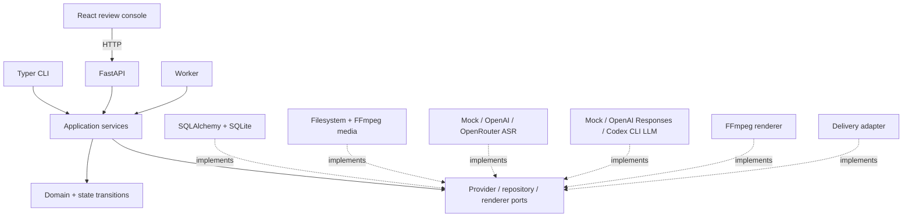

## Workspace identity and project visibility

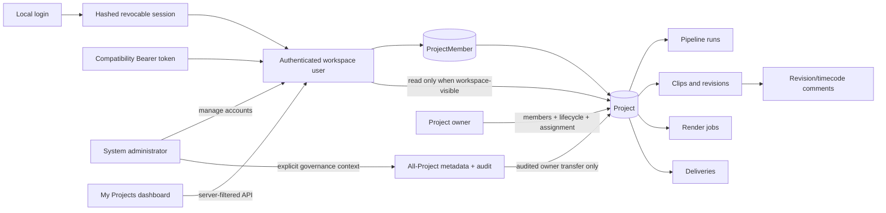

The ordinary browser workspace never filters a global Project collection: the API returns explicit memberships plus authenticated read-only access to Projects intentionally marked workspace-visible, and repeats the same policy for every descendant resource. New Projects are private. A separate administrator governance endpoint can list safe metadata for every Project and transfer ownership under an audited same-transaction authority fence; it does not create membership or expose descendant media/export access. Its dedicated DTO includes inactive owners so account disable cannot make an orphaned Project ungovernable. Every administrator DB operation rechecks the live enabled system role in its transaction; long filesystem storage scans recheck again before returning, so a request-start identity snapshot cannot outlive concurrent revocation. SQLite stores Argon2id verifiers and session digests, never plaintext credentials; Provider credentials stay in ignored environment configuration. System administrator, Project role and visibility are independent authority dimensions. API DTOs expose server-derived capabilities, so the Web does not copy the role matrix.

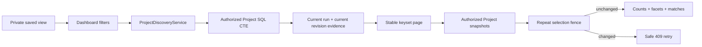

Saved views belong to one user and store only strict versioned criteria. Search
uses NFKC/casefolded parameterized substrings, preserves the first page's clock in
the cursor, and treats a disabled assignee as operationally unassigned. Neither a
cursor nor a saved view grants access; every page starts from current server
authorization.

## Data flow and cloud boundary

```mermaid
flowchart LR
  SOURCE[(Local source video)] --> PRE[Local audio preprocessing]
  PRE --> CHUNKS[Local compressed chunks]
  CHUNKS -->|audio only| ROUTER[OpenRouter]
  ROUTER -->|routed audio| OASR[Whisper Large V3 host]
  OASR --> TRANSCRIPT[(Local transcript)]
  TRANSCRIPT --> CAND[Local deterministic candidates]
  CAND -->|bounded text + metadata| EDITOR[OpenAI Responses or local Codex CLI process]
  EDITOR -->|cloud inference; no tools| VALIDATE[Local strict validation]
  VALIDATE --> META[Separate title / Hook / reason / risks / captions]
  VALIDATE --> PROXY[Local clean proxy renderer]
  META --> REVIEW[Human review]
  PROXY --> REVIEW
  REVIEW --> FINAL[Local final renderer with approved overlays]
  SOURCE --> PROXY
  SOURCE --> FINAL
  FINAL --> LOCAL[(Local finals/deliveries)]
  PROXY --> LOCAL_PROXY[(Local review proxies)]
```

Video frames, files, database, proxies, finals and deliveries stay local. In the default chain, prepared audio passes through OpenRouter to its selected Whisper host. Bounded transcript data then goes separately to the local Codex CLI process, whose inference remains cloud-based through saved ChatGPT authentication. Codex never receives source video/audio and is not ASR. Direct OpenAI ASR/Responses modes remain explicit alternatives.

## Pipeline and review

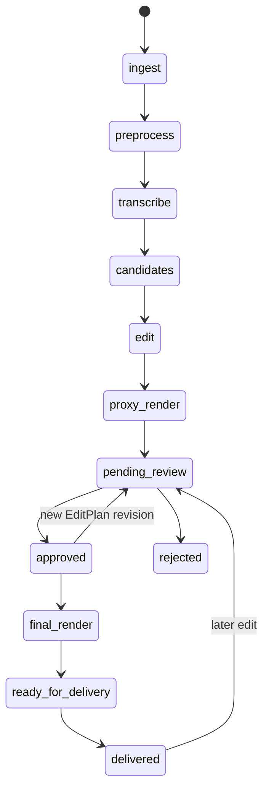

PipelineRun, StageRun, review, Render and Delivery each have separate state machines; the diagram is user flow, not a single status enum.

## Revision-bound collaboration

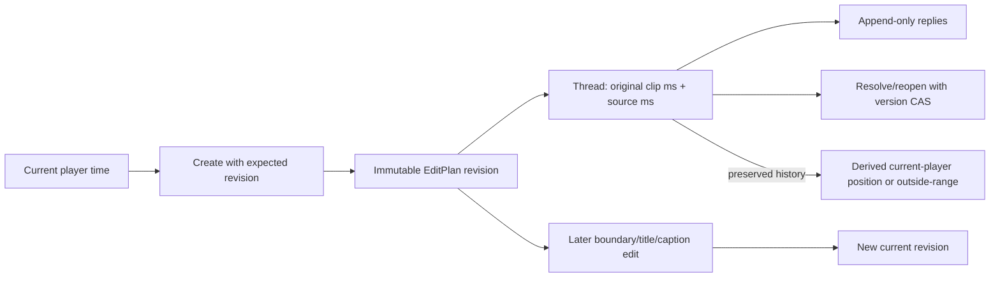

Comments never mutate EditPlan, review, Render or lifecycle state. Owner/editor/reviewer writes are authorized again inside the SQLite transaction; viewer/workspace-visible access is read-only and archive freezes the discussion. A reply has no client version fence because valid concurrent messages must both append. Resolve/reopen changes shared state and uses the thread version. Mentions target active explicit Project members, identity is snapshotted for history, and audit metadata excludes bodies.

## Professional project lifecycle

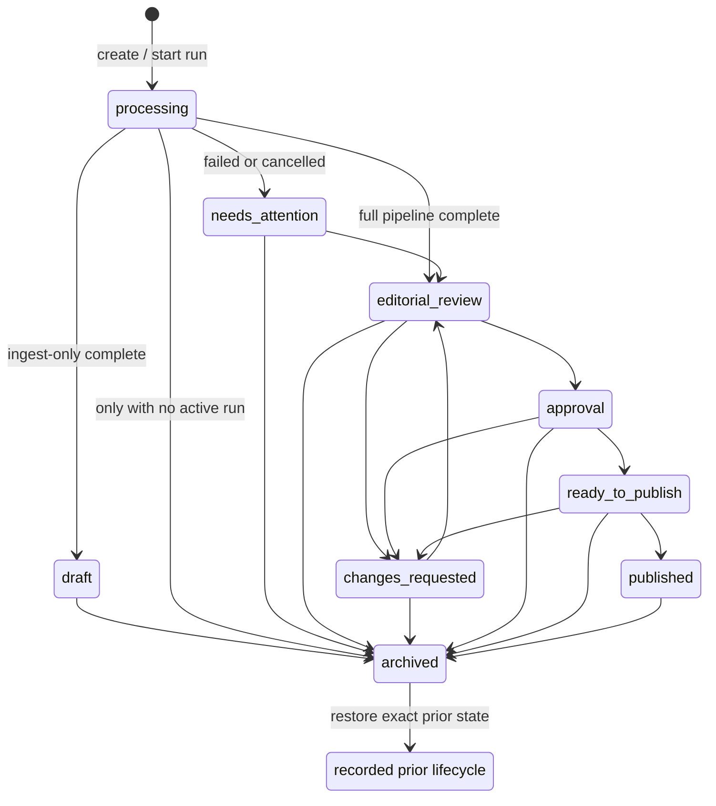

This business lifecycle is not the computed technical Project status. Manual transitions come only from the domain table returned by the API; Pipeline terminal signals may move processing/attention/review states, but Delivery never asserts `published`. Owner mutations use an optimistic management version, a required lifecycle reason and an audit event. Archive preserves the exact restore target and makes ordinary Project writes unavailable.

## Retention, purge, and recovery boundary

```mermaid
flowchart LR
    Admin[Current administrator + CSRF] --> Plan[No-follow dry-run fingerprint]
    Plan --> Confirm[Exact project name + PURGE project ID]
    Confirm --> Backup[SQLite online backup\nquick/FK/revision/hash]
    Backup --> Fence[Short transaction\nadmin/state/source fence]
    Fence --> Quarantine[O(1) exact-inode rename]
    Quarantine --> Verify[Transaction-free\nno-follow tree verification]
    Verify --> Delete[Short transaction\nrepeat fence + graph delete + audit]
    Delete --> Cleanup[Transaction-free recursive cleanup]
    Cleanup -->|failure| Pending[Visible identity-bound cleanup pending]
    Source[External SourceMedia] -. never delete .-> Fence
    DataRoot[LIVECLIP_DATA_DIR] -. forbidden as new source .-> Source
```

Archive retains all files and can restore the exact prior lifecycle. Routine cleanup cannot delete committed assets. It claims terminal attempts with the same short source/inode fence and deletes their quarantined trees without holding SQLite's writer lock, so active Worker heartbeats remain available. Permanent purge is a separate administrator action and is refused for any source reference under generated scope; all new source paths below `LIVECLIP_DATA_DIR` are rejected before Project insertion. A failed verification/database transaction moves the same quarantined inode back, startup restores a started-only purge, and a post-commit cleanup failure remains visible. Backup/restore always publishes a new SQLite file and never overwrites the live endpoint.

## Durable command and media access

```mermaid
flowchart LR
  UI[Web / CLI / REST] --> SVC[Shared application service]
  SVC -->|BEGIN IMMEDIATE| TASK[(SQLite Task + lease fence)]
  TASK --> CLAIM[Worker or foreground claim]
  CLAIM --> TMP[Task-scoped temporary output]
  TMP --> PIN[No-follow pinned FD + size + SHA]
  PIN --> CHECK[Same bytes: ffprobe + full decode + quality]
  CHECK -->|expected SHA + no-replace publish + DB fence| ASSET[(Committed Asset)]
  UI -->|poll resource ID| SVC
  ASSET --> SIGN[Short-lived path/purpose HMAC URL]
  SIGN --> RANGE[No-follow verified HTTP Range stream]
```

Long operations return durable IDs immediately. Foreground CLI and Worker compete through the same atomic claim; neither adapter bypasses the lease, generation, revision or input-fingerprint fences. Browser media URLs expose generated asset IDs, never arbitrary source paths.

## Delivery byte identity

```mermaid
flowchart LR
  APPROVED[Approved current render + SRT] --> PIN[Pin each member FD + SHA]
  PIN --> ZIP[Stream members into pinned ZIP FD]
  ZIP --> VERIFY[Verify every ZIP member + manifest]
  VERIFY --> TREE[Pin exact directory tree]
  TREE --> RENAME[Atomic no-replace rename]
  RENAME --> REHASH[Rebind + rehash every canonical member]
  REHASH --> COMMIT[Asset commit with expected SHA]
```

No ZIP member is reopened by an ordinary pathname after validation. A member or archive endpoint replacement fails publication or recovery; it cannot become a successful Delivery.

## Selective editor handoff

```mermaid
flowchart LR
  UI[Owner/editor selects exact current revisions] --> SNAP[SQLite EditPackage snapshot]
  SNAP --> LEASE[Shared heavy-task lease]
  LEASE --> LINEAGE[Recheck clean proxy + producer attempt + hashes]
  LINEAGE --> COPY[Copy pinned MP4/contact sheet]
  COPY --> META[Write relative SRT + JSON/CSV + guide]
  META --> VERIFY[Codec/full decode + checksums + ZIP verification]
  VERIFY --> FENCE[Authority/generation/revision/Asset fence]
  FENCE --> PUBLISH[Atomic no-replace edit-packages/vNNN]
  PUBLISH --> DOWNLOAD[Revision-bound individual files or signed ZIP]
```

`EditPackage` is neither Review nor formal Delivery. It may snapshot pending-review clips, never burns LiveClip text, never changes Project lifecycle/status and never invokes ASR or LLM. The selection keeps its original exact revision even when a later edit makes the old clean proxy stale; queued/creating work fails closed, while an already succeeded version remains an immutable historical handoff.

## Release planning and platform package

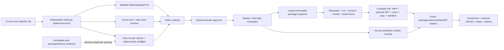

Release approval, queue state, formal Delivery and Project lifecycle are distinct evidence. The Web renders capabilities returned by the server: an editor manages metadata and submits, while an owner/reviewer approves, returns or revokes approval. Platform presets are dated immutable configuration with one selected current version and resolvable history; hard blockers are limited to verified media rules and local evidence, while account-specific policy remains a required human confirmation. Duplicate evidence is a warning only, and its enqueue-time form is frozen for deterministic package recovery while excluded from material-current fingerprints. LiveClip stores no platform credential and `scheduled_external` never claims an upload. Package execution shares SQLite leases, pins the exact current producer lineage, validates actual bytes, extracts the cover with system-owned FFmpeg argv and publishes a no-replace version directory. Recovery regenerates deterministic members instead of trusting self-reported hashes and transfers exact committed Asset ownership to the successor attempt. A lost runner never withdraws; an owned failure uses one short transaction to fence the lease/Assets and move only the expected directory inode to its attempt quarantine before invalidation, with recursive cleanup after commit. Release-item changes, clip revisions and new runs fail active package resources and cancel/fence their Tasks in the same transaction; successful package versions remain immutable. Publication then pins one exact current successful ZIP and persists its hashes together with the operator's actual timestamp and external result.

## EditPlan execution boundary

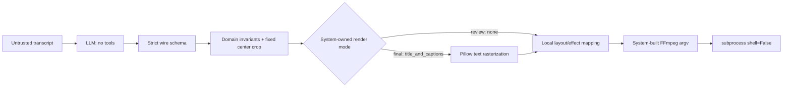

No path, command, layout, filtergraph, SQL, code or script is accepted from the model. The renderer uses one source-video layer and cannot construct a blurred background or duplicated foreground.

For MPEG-TS/long-GOP input, system-owned FFmpeg argv performs a bounded early seek plus accurate output seek. Audio and video keep their relative PTS through the filtergraph; only the muxed result is moved onto the clip timeline. This prevents independent `STARTPTS` resets from hiding undecodable HEVC lead-in frames and creating a permanent lip-sync offset.

Review proxies always use the `none` text mode and expose editorial fields separately. Final renders use `title_and_captions` only for the approved current revision. The text mode participates in the render fingerprint.

## Revision and invalidation

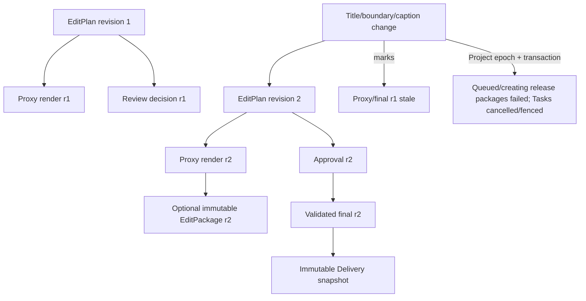
