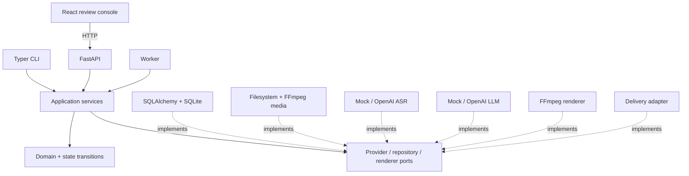
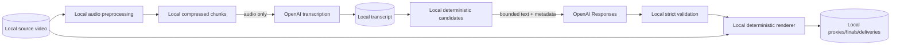
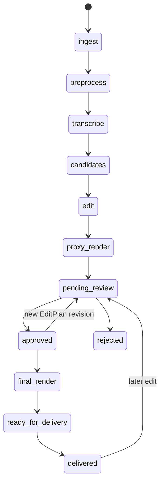
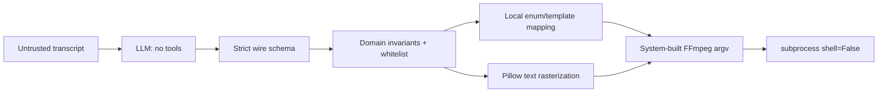
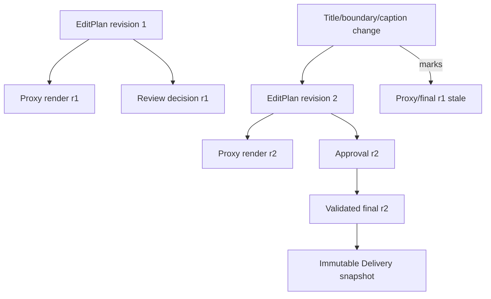

# Architecture

`docs/SOLUTION.md` is the detailed decision document. These diagrams summarize the durable boundaries.

## Modules

## Data flow and cloud boundary

Video frames, files, database, proxies, finals and deliveries stay local. OpenAI receives prepared audio for ASR and bounded transcript data for editing.

## Pipeline and review

PipelineRun, StageRun, review, Render and Delivery each have separate state machines; the diagram is user flow, not a single status enum.

## Durable command and media access

```mermaid
flowchart LR
  UI[Web / CLI / REST] --> SVC[Shared application service]
  SVC -->|BEGIN IMMEDIATE| TASK[(SQLite Task + lease fence)]
  TASK --> CLAIM[Worker or foreground claim]
  CLAIM --> TMP[Task-scoped temporary output]
  TMP --> PIN[No-follow pinned FD + size + SHA]
  PIN --> CHECK[Same bytes: ffprobe + full decode + quality]
  CHECK -->|expected SHA + no-replace publish + DB fence| ASSET[(Committed Asset)]
  UI -->|poll resource ID| SVC
  ASSET --> SIGN[Short-lived path/purpose HMAC URL]
  SIGN --> RANGE[No-follow verified HTTP Range stream]
```

Long operations return durable IDs immediately. Foreground CLI and Worker compete through the same atomic claim; neither adapter bypasses the lease, generation, revision or input-fingerprint fences. Browser media URLs expose generated asset IDs, never arbitrary source paths.

## Delivery byte identity

```mermaid
flowchart LR
  APPROVED[Approved current render + SRT] --> PIN[Pin each member FD + SHA]
  PIN --> ZIP[Stream members into pinned ZIP FD]
  ZIP --> VERIFY[Verify every ZIP member + manifest]
  VERIFY --> TREE[Pin exact directory tree]
  TREE --> RENAME[Atomic no-replace rename]
  RENAME --> REHASH[Rebind + rehash every canonical member]
  REHASH --> COMMIT[Asset commit with expected SHA]
```

No ZIP member is reopened by an ordinary pathname after validation. A member or archive endpoint replacement fails publication or recovery; it cannot become a successful Delivery.

## EditPlan execution boundary

No path, command, filtergraph, SQL, code or script is accepted from the model.

## Revision and invalidation

