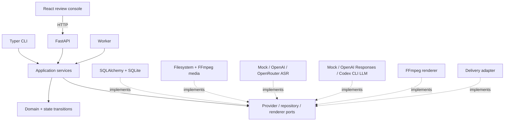
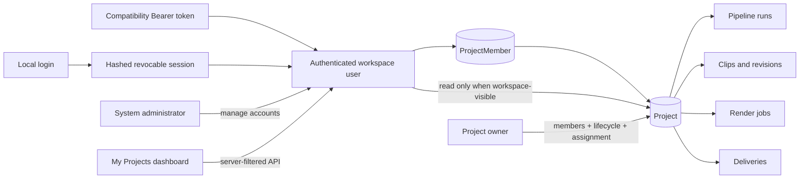
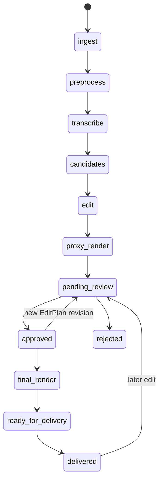
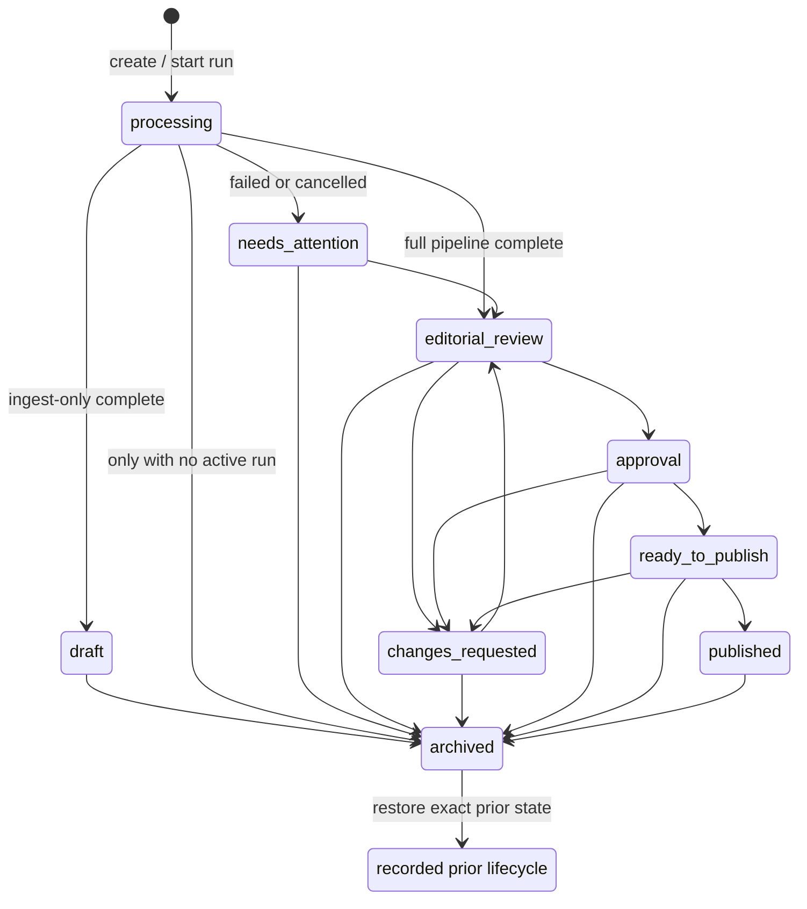
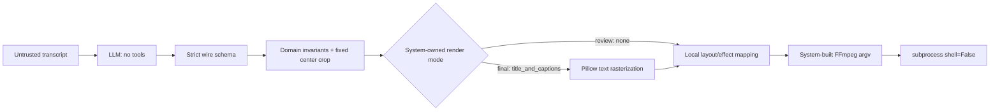
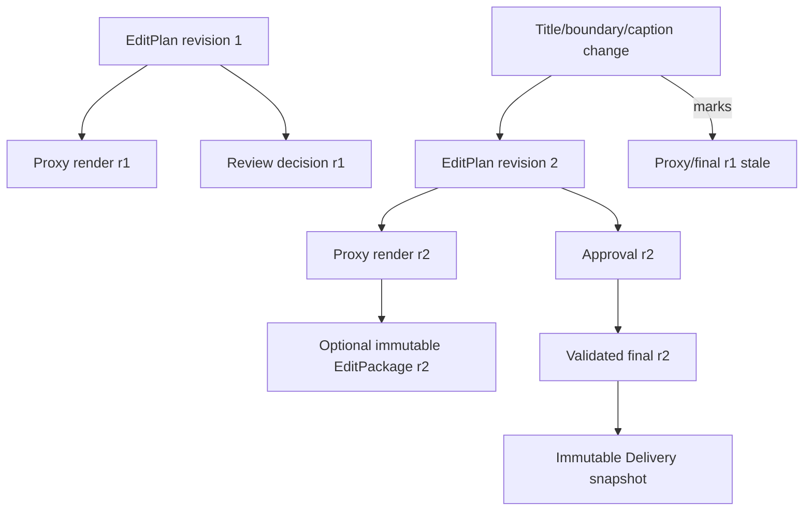

# Architecture

`docs/SOLUTION.md` is the detailed decision document. These diagrams summarize the durable boundaries.

## Modules

## Workspace identity and project visibility

The browser never filters a global Project collection. The API returns explicit memberships plus authenticated read-only access to Projects intentionally marked workspace-visible, and repeats the same policy for every descendant resource. New Projects are private. SQLite stores Argon2id verifiers and session digests, never plaintext credentials; Provider credentials stay in ignored environment configuration. System administrator, Project role and visibility are independent authority dimensions. API DTOs expose server-derived capabilities, so the Web does not copy the role matrix.

## Data flow and cloud boundary

```mermaid
flowchart LR
  SOURCE[(Local source video)] --> PRE[Local audio preprocessing]
  PRE --> CHUNKS[Local compressed chunks]
  CHUNKS -->|audio only| ROUTER[OpenRouter]
  ROUTER -->|routed audio| OASR[Whisper Large V3 host]
  OASR --> TRANSCRIPT[(Local transcript)]
  TRANSCRIPT --> CAND[Local deterministic candidates]
  CAND -->|bounded text + metadata| EDITOR[OpenAI Responses or local Codex CLI process]
  EDITOR -->|cloud inference; no tools| VALIDATE[Local strict validation]
  VALIDATE --> META[Separate title / Hook / reason / risks / captions]
  VALIDATE --> PROXY[Local clean proxy renderer]
  META --> REVIEW[Human review]
  PROXY --> REVIEW
  REVIEW --> FINAL[Local final renderer with approved overlays]
  SOURCE --> PROXY
  SOURCE --> FINAL
  FINAL --> LOCAL[(Local finals/deliveries)]
  PROXY --> LOCAL_PROXY[(Local review proxies)]
```

Video frames, files, database, proxies, finals and deliveries stay local. In the default chain, prepared audio passes through OpenRouter to its selected Whisper host. Bounded transcript data then goes separately to the local Codex CLI process, whose inference remains cloud-based through saved ChatGPT authentication. Codex never receives source video/audio and is not ASR. Direct OpenAI ASR/Responses modes remain explicit alternatives.

## Pipeline and review

PipelineRun, StageRun, review, Render and Delivery each have separate state machines; the diagram is user flow, not a single status enum.

## Professional project lifecycle

This business lifecycle is not the computed technical Project status. Manual transitions come only from the domain table returned by the API; Pipeline terminal signals may move processing/attention/review states, but Delivery never asserts `published`. Owner mutations use an optimistic management version, a required lifecycle reason and an audit event. Archive preserves the exact restore target and makes ordinary Project writes unavailable.

## Durable command and media access

```mermaid
flowchart LR
  UI[Web / CLI / REST] --> SVC[Shared application service]
  SVC -->|BEGIN IMMEDIATE| TASK[(SQLite Task + lease fence)]
  TASK --> CLAIM[Worker or foreground claim]
  CLAIM --> TMP[Task-scoped temporary output]
  TMP --> PIN[No-follow pinned FD + size + SHA]
  PIN --> CHECK[Same bytes: ffprobe + full decode + quality]
  CHECK -->|expected SHA + no-replace publish + DB fence| ASSET[(Committed Asset)]
  UI -->|poll resource ID| SVC
  ASSET --> SIGN[Short-lived path/purpose HMAC URL]
  SIGN --> RANGE[No-follow verified HTTP Range stream]
```

Long operations return durable IDs immediately. Foreground CLI and Worker compete through the same atomic claim; neither adapter bypasses the lease, generation, revision or input-fingerprint fences. Browser media URLs expose generated asset IDs, never arbitrary source paths.

## Delivery byte identity

```mermaid
flowchart LR
  APPROVED[Approved current render + SRT] --> PIN[Pin each member FD + SHA]
  PIN --> ZIP[Stream members into pinned ZIP FD]
  ZIP --> VERIFY[Verify every ZIP member + manifest]
  VERIFY --> TREE[Pin exact directory tree]
  TREE --> RENAME[Atomic no-replace rename]
  RENAME --> REHASH[Rebind + rehash every canonical member]
  REHASH --> COMMIT[Asset commit with expected SHA]
```

No ZIP member is reopened by an ordinary pathname after validation. A member or archive endpoint replacement fails publication or recovery; it cannot become a successful Delivery.

## Selective editor handoff

```mermaid
flowchart LR
  UI[Owner/editor selects exact current revisions] --> SNAP[SQLite EditPackage snapshot]
  SNAP --> LEASE[Shared heavy-task lease]
  LEASE --> LINEAGE[Recheck clean proxy + producer attempt + hashes]
  LINEAGE --> COPY[Copy pinned MP4/contact sheet]
  COPY --> META[Write relative SRT + JSON/CSV + guide]
  META --> VERIFY[Codec/full decode + checksums + ZIP verification]
  VERIFY --> FENCE[Authority/generation/revision/Asset fence]
  FENCE --> PUBLISH[Atomic no-replace edit-packages/vNNN]
  PUBLISH --> DOWNLOAD[Revision-bound individual files or signed ZIP]
```

`EditPackage` is neither Review nor formal Delivery. It may snapshot pending-review clips, never burns LiveClip text, never changes Project lifecycle/status and never invokes ASR or LLM. The selection keeps its original exact revision even when a later edit makes the old clean proxy stale; queued/creating work fails closed, while an already succeeded version remains an immutable historical handoff.

## EditPlan execution boundary

No path, command, layout, filtergraph, SQL, code or script is accepted from the model. The renderer uses one source-video layer and cannot construct a blurred background or duplicated foreground.

Review proxies always use the `none` text mode and expose editorial fields separately. Final renders use `title_and_captions` only for the approved current revision. The text mode participates in the render fingerprint.

## Revision and invalidation

