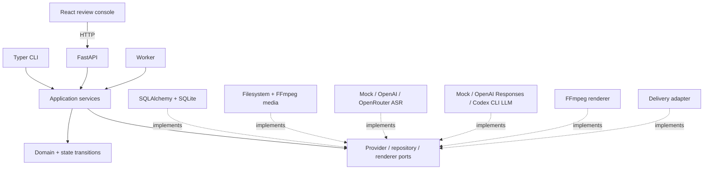
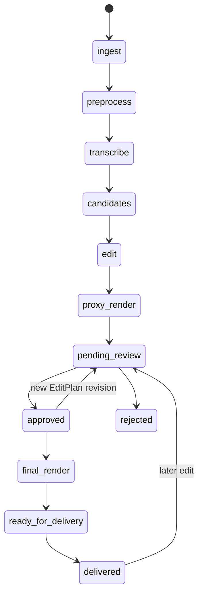
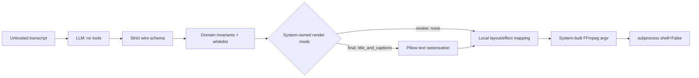
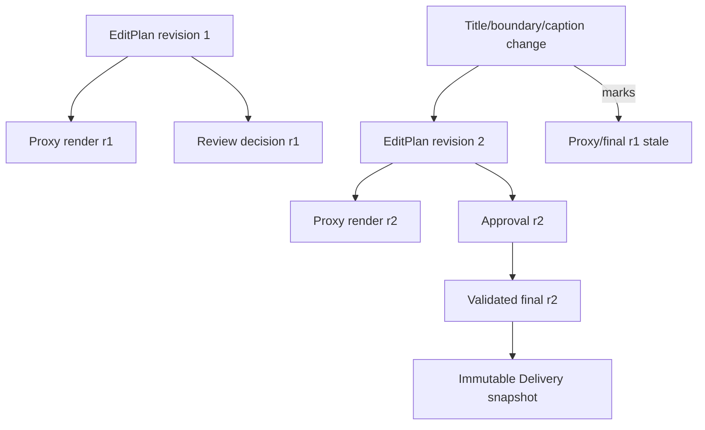

# Architecture

`docs/SOLUTION.md` is the detailed decision document. These diagrams summarize the durable boundaries.

## Modules

## Data flow and cloud boundary

```mermaid
flowchart LR
  SOURCE[(Local source video)] --> PRE[Local audio preprocessing]
  PRE --> CHUNKS[Local compressed chunks]
  CHUNKS -->|audio only| ROUTER[OpenRouter]
  ROUTER -->|routed audio| OASR[Whisper Large V3 host]
  OASR --> TRANSCRIPT[(Local transcript)]
  TRANSCRIPT --> CAND[Local deterministic candidates]
  CAND -->|bounded text + metadata| EDITOR[OpenAI Responses or local Codex CLI process]
  EDITOR -->|cloud inference; no tools| VALIDATE[Local strict validation]
  VALIDATE --> META[Separate title / Hook / reason / risks / captions]
  VALIDATE --> PROXY[Local clean proxy renderer]
  META --> REVIEW[Human review]
  PROXY --> REVIEW
  REVIEW --> FINAL[Local final renderer with approved overlays]
  SOURCE --> PROXY
  SOURCE --> FINAL
  FINAL --> LOCAL[(Local finals/deliveries)]
  PROXY --> LOCAL_PROXY[(Local review proxies)]
```

Video frames, files, database, proxies, finals and deliveries stay local. In the default chain, prepared audio passes through OpenRouter to its selected Whisper host. Bounded transcript data then goes separately to the local Codex CLI process, whose inference remains cloud-based through saved ChatGPT authentication. Codex never receives source video/audio and is not ASR. Direct OpenAI ASR/Responses modes remain explicit alternatives.

## Pipeline and review

PipelineRun, StageRun, review, Render and Delivery each have separate state machines; the diagram is user flow, not a single status enum.

## Durable command and media access

```mermaid
flowchart LR
  UI[Web / CLI / REST] --> SVC[Shared application service]
  SVC -->|BEGIN IMMEDIATE| TASK[(SQLite Task + lease fence)]
  TASK --> CLAIM[Worker or foreground claim]
  CLAIM --> TMP[Task-scoped temporary output]
  TMP --> PIN[No-follow pinned FD + size + SHA]
  PIN --> CHECK[Same bytes: ffprobe + full decode + quality]
  CHECK -->|expected SHA + no-replace publish + DB fence| ASSET[(Committed Asset)]
  UI -->|poll resource ID| SVC
  ASSET --> SIGN[Short-lived path/purpose HMAC URL]
  SIGN --> RANGE[No-follow verified HTTP Range stream]
```

Long operations return durable IDs immediately. Foreground CLI and Worker compete through the same atomic claim; neither adapter bypasses the lease, generation, revision or input-fingerprint fences. Browser media URLs expose generated asset IDs, never arbitrary source paths.

## Delivery byte identity

```mermaid
flowchart LR
  APPROVED[Approved current render + SRT] --> PIN[Pin each member FD + SHA]
  PIN --> ZIP[Stream members into pinned ZIP FD]
  ZIP --> VERIFY[Verify every ZIP member + manifest]
  VERIFY --> TREE[Pin exact directory tree]
  TREE --> RENAME[Atomic no-replace rename]
  RENAME --> REHASH[Rebind + rehash every canonical member]
  REHASH --> COMMIT[Asset commit with expected SHA]
```

No ZIP member is reopened by an ordinary pathname after validation. A member or archive endpoint replacement fails publication or recovery; it cannot become a successful Delivery.

## EditPlan execution boundary

No path, command, filtergraph, SQL, code or script is accepted from the model.

Review proxies always use the `none` text mode and expose editorial fields separately. Final renders use `title_and_captions` only for the approved current revision. The text mode participates in the render fingerprint.

## Revision and invalidation

