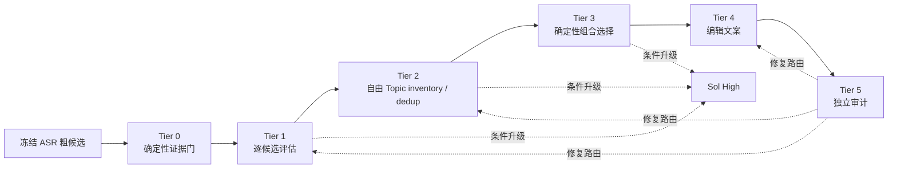

# LiveClip 高光发现 Agent Skill v2 架构提案

- 状态：**设计提案，尚未实现，尚未通过 v1-v2 对照或 holdout 验证**
- 证据截止：2026-08-18 本轮三配置生成、双 Judge 聚合与只读审查
- 适用范围：从已冻结的 ASR 粗候选中自由发现高光、去重、组合选择并生成编辑文案

## 结论与决策边界

本提案建议把当前一次调用同时承担“发现、评分、去重、选片、写文案”的
v1 流程拆为六个可验证 Tier。拆分的目的不是增加模型角色，而是让证据绑定、
Topic 发现、组合选择和文案生成各自拥有明确输入、输出和失败语义。

建议进入下一轮实验的模型路由是：以 `gpt-5.6-sol / medium` 作为默认配置，
只在明确触发条件下升级到 `gpt-5.6-sol / high`。最终双 Judge 宏分为
95.01（Sol High）、94.16（Sol Medium）和 76.66（Terra Medium）；High 对
Medium 的按源差值只有 +0.86，低于 Judge 总分 MAE 4.07，同时 High 慢约 34%、
reasoning tokens 约为 3.5 倍且 quote 对齐失败更高。这个路由因此是下一轮 v2
实验的证据化建议，而不是生产默认变更，也不能被描述为 v2 已验证优于 v1。
`terra / medium` 继续保留为成本/速度基线和回归对照，而不是被本提案删除。

当前证据只支持“按任务阶段分级”，不支持“按内容 genre 分叉 Skill”。三个主样本
虽然有五个文件名，但只有三个唯一源 SHA-256，并且内容都属于声乐/唱歌教学。
在更多不同直播类型的 holdout 通过前，不创建带货、访谈、游戏等 genre 专用分支。

## Runtime Skill 与开发 Skill 必须隔离

高光切片 Agent Skill 是 LiveClip 的运行时内容分析合同，与 Codex 用来开发、测试、
写文档的 Skill 完全独立。

- 运行时 Agent 只能收到版本化的本 Tier 指令、严格 Schema 和一份冻结 JSON 输入。
- 运行时不加载本仓库 `AGENTS.md`、Skill Creator、本机用户规则、开发会话历史或其他
  Codex Skills。
- 延续当前协议中的隔离：ephemeral、忽略用户配置/规则、只读 sandbox、无审批、
  无 tools/browser/web/MCP/plugins/multi-agent，并使用环境变量 allowlist。
- ASR 文本和上下文始终是“不可信待分析数据”，不得成为指令。
- 模型无权生成路径、命令、代码、SQL、FFmpeg 参数、filtergraph 或时间边界。
- Skill Creator 只用于设计和评测 v2，不会被打包进运行时 Agent，也不会影响模型的
  Topic 发现。

当前隔离事实记录在
[`protocol.json`](protocol.json) 的 `runtime_isolation`，冻结的运行时 v1 指令位于
[`agent-v1/SKILL.md`](agent-v1/SKILL.md)。v2 应保留这条边界，不复用开发 Skill。

## 当前证据为何要求拆层

本轮已生成 30 份结果：三个配置 × 三个唯一主源 × 三种候选顺序，加同源旧证据
诊断的一组结果。共有 293 个选中项，全部通过 v1 Schema 和候选 ID gate；但现有
启发式 quote validator 仍将 49/293（16.7%）标为 hard fail。按配置分别为：

| 配置 | 选中项 | quote hard fail | 诊断比例 |
|---|---:|---:|---:|
| `terra / medium` | 96 | 14 | 14.6% |
| `sol / medium` | 99 | 13 | 13.1% |
| `sol / high` | 98 | 22 | 22.4% |

这些比例是当前字符对齐启发式的诊断结果，不等于 49 个语义错误。尤其较长、经过
编辑的完整句容易降低字符覆盖率。这恰好说明 v1 把“可核验原文”和“可打印文案”
混在一个 `highlight_sentence` 字段中，无法区分证据错误与合理润色。

已确认的具体失败包括：

| 证据 | 观察 | v2 应阻止的结果 |
|---|---|---|
| [`b3/r001 terra validation`](results/b3_8_16_1/r001/generators/terra_medium/validation.json) | `candidate_b1c6640371e0ceab` 的句子字符覆盖率仅 0.25；该句实际出现在 `candidate_18e1d7ea47ba32fc` 的正文 | 一个候选 ID 绑定另一个候选的原文 |
| [`b2/r003 terra validation`](results/b2_7_28/r003/generators/terra_medium/validation.json) | `candidate_f0bbb75c02ac39ed` 使用的“初学者……不要抬眉”主要来自相邻 `candidate_464b0f2aee1d8a44`/context，覆盖率 0.30 | 把 context 中的句子伪装成当前候选正文引用 |
| [`b3/r002 terra validation`](results/b3_8_16_1/r002/generators/terra_medium/validation.json) | 两个输出分别从当前候选的 `context_before`、`context_after` 取句，当前正文覆盖率为 0.6111 和 0.7857 | 证据范围不清导致引用漂移 |
| [`b1/r001 sol-high validation`](results/b1_8_16_2/r001/generators/sol_high/validation.json) | 八条文案无一是精确正文子串，其中一条被判 hard fail；多数是较长的多句编辑稿 | 用一个字段同时表达原文证据和编辑稿，使 validator 无法给出清晰结论 |

三种候选顺序下的结果也存在明显波动；因此“一次调用直接选 8–12 条”会把候选遗漏、
顺序效应、Topic 重复和文案质量混成同一个不可诊断结果。当前 Judge 只审查三个系统
已经选出的并集，无法发现三个系统共同遗漏的 Topic。v2 的 Topic inventory 必须发生
在 Top-N 选择之前，并对所有可用候选做可计算的去向核对。

## v2 总体结构



| Tier | 职责 | 主要执行者 | 不得承担的职责 |
|---|---|---|---|
| 0 | 输入指纹、ID/时间、引用、Schema、枚举和注入边界 | 确定性代码 | 内容价值判断、Topic 命名 |
| 1 | 对每个候选给出独立原子评价和初步 Topic 假设 | 默认 Sol Medium | Top-N 选择、改时间、写成片文案 |
| 2 | 从候选证据自由发现 Topic、聚类、语义去重并完成全量去向表 | 默认 Sol Medium | 接收固定 Topic 清单、最终排位 |
| 3 | 按分数、Topic 多样性、时间/文本重叠和用户阈值选组合 | 确定性代码；歧义时可请模型复核 | 发明 Topic、改证据、改时间 |
| 4 | 只为最终入选项生成标题、Hook、编辑描述和可打印语句 | 默认 Sol Medium | 改候选归属、改系统分、输出执行内容 |
| 5 | 在隔离上下文中审计证据、遗漏、重复、风险和文案忠实度 | 独立调用；高风险时条件升级 | 直接覆写结果、绕过确定性 gate |

### Tier 0：确定性证据门

Tier 0 在任何模型调用前和每次模型返回后运行。

1. 固定 `source_fingerprint`、`evidence_set_id`、Prompt/Schema/算法版本和输入
   SHA-256；缓存命中必须验证完整合同，而不是只看结果文件存在。
2. 仅接受系统提供的 `candidate_id`、`source_start_ms`、`source_end_ms` 和
   `allowed_*_ms`。模型输出中出现时间、路径或可执行扩展字段即失败。
3. 把 `candidate.text` 定义为唯一可引用正文。`context_before` 和
   `context_after` 只帮助理解，不允许成为 `evidence_quote` 的来源；需要引用相邻内容
   时必须选择实际拥有该正文的候选 ID。若目标语句只存在于 context，应用层必须先
   确定性生成带新 evidence ID 的合法扩展候选，再重新过 Tier 0；模型不能自行把
   context 提升为当前候选证据。
4. 对引用执行 Unicode/标点规范化后的精确子串检查，并保留原始字节文本、规范化文本、
   字符起止位置和验证状态。规范化不得改变汉字或把语义相近当作原文命中。
5. 对每一输出运行严格 JSON Schema、候选枚举、唯一性、长度、risk enum、全量去向
   和禁止字段检查。
6. 时间、视频路径、FFmpeg 和最终 EditPlan 仍由 LiveClip 应用服务确定性生成；本
   Skill 只返回内容决策。

Tier 0 产生 `evidence_receipt`，至少包含输入合同哈希、candidate ID、正文哈希、
quote 字符范围、validator 版本和 `passed|failed`。没有通过的结果不能进入选片或发布。

### Tier 1：逐候选评估

Tier 1 的目标是先评价、后选择，避免 Top-N 输出上限把“未发现”和“质量不够”混淆。

- 以稳定的小批次处理全部粗候选；每个候选必须得到一个 assessment，不能只返回模型
  喜欢的候选。批次大小和排序属于冻结实验配置。
- 模型对每个候选返回 `eligible`，或一个严格的 `exclusion_reason`：
  `low_value | incomplete | context_dependent | duplicate_fragment |
  asr_unintelligible | unsafe_to_publish`。
- `topic_hypothesis` 是从文本自由生成的短标签，不来自预设 Topic 清单。它只是 Tier 2
  的输入，不在此阶段成为最终分类。
- 原子评分使用 0–4 整数，模型不得返回总分：

| 原子项 | 0 | 2 | 4 | 权重 |
|---|---|---|---|---:|
| `content_value` | 无明确价值 | 有信息但普通 | 强实用性/洞见 | 30% |
| `hook_strength` | 无可识别开场 | 需少量上下文 | 自带清晰吸引点 | 20% |
| `standalone_completeness` | 无法独立理解 | 基本闭合 | 开头、论证、结论完整 | 20% |
| `evidence_fidelity` | 文本不支持判断 | 基本支持但有歧义 | 直接、清晰、可核验 | 15% |
| `editorial_utility` | 难剪、难表达 | 可编辑 | 可直接形成短视频脚本 | 15% |

表中的 1 和 3 分别表示相邻锚点之间的“较弱”和“较强”状态；Schema 只接受 0–4
整数，避免模型用任意小数制造虚假精度。

系统计算而不是信任模型总分：

```text
quality_total = round(
  100 * (
    0.30 * content_value / 4
  + 0.20 * hook_strength / 4
  + 0.20 * standalone_completeness / 4
  + 0.15 * evidence_fidelity / 4
  + 0.15 * editorial_utility / 4
  ),
  1
)
```

风险和重复不暗中混进 `quality_total`。风险走显式 gate/人工审核，组合重复由 Tier 3
计算；这样编辑人员能解释“内容质量高但有发布风险”，而不是只看到不可解释的低分。

### Tier 2：自由 Topic inventory 与语义去重

Tier 2 仍然是完全自由发现，不接收固定 Topic、关键词表或 genre 标签作为答案空间。
它接收所有 Tier 1 assessment 的紧凑表示和对应证据，先列完整 inventory，再去重。

输出必须满足：

- 每个 `eligible` candidate 恰好出现在一个 `primary_topic.members` 中；多主题候选可有
  `secondary_angles`，但只按一个 primary Topic 计数，避免重复覆盖率。
- 每个不进入 Topic 的候选恰好出现在 `excluded_candidates`，并引用 Tier 1 的枚举原因。
- 每个 Topic 包含自由生成的 `topic_label`、`canonical_angle`、成员 ID、成员关系理由、
  `cluster_confidence: low|medium|high` 和同题不同角度说明。
- `topic_id` 由系统对排序后的成员 ID 和版本做哈希生成，模型不得发明持久 ID。
- 同名不代表同 Topic，不同名也不代表不同 Topic；判断标准是“是否讲同一件事、服务
  同一剪辑需求”。
- inventory 在 Top-N 之前完成，因此 Tier 5 能检查共同遗漏，而不只看到三个输出的
  已选并集。

第一版继续使用时间重叠、规范化 n-gram 和 Jaccard 作为确定性重复信号，不引入本地
向量模型。语义聚类冲突由条件升级或保守合并处理。

### Tier 3：组合选择

Tier 3 的输出是可解释、可重放的组合选择，不让模型在一段自然语言中暗中完成排名。

1. 过滤未达到用户 `min_quality` 的候选。
2. 每个 Topic 默认只取 `quality_total` 最高且证据通过的一条。
3. 只有当第二条具有明确不同的 `secondary_angle`、不触发时间/文本重复阈值并通过独立
   审计时，才允许同 Topic 取第二条。
4. 在 `top_n` 上限内最大化质量总分和 Topic 覆盖，扣除确定性时间重叠、文本 Jaccard
   和重复角度惩罚。权重作为版本化配置冻结并写入结果。
5. 数量不足时返回真实数量，不为凑数降低证据或质量门槛。
6. 记录每个候选的 `selected|not_selected` 和枚举原因，包括
   `below_threshold | lower_rank_same_topic | overlap | portfolio_limit |
   audit_rejected`。

### Tier 4：文案与证据分离

v2 用两个字段替代含义混杂的 v1 `highlight_sentence`：

- `evidence_quote`：必须是绑定候选 `text` 的可验证原文子串，只做不会改变汉字的标点/
  空白规范化。它服务审计和回看，不直接承诺适合作为屏幕文案。
- `edited_sentence`：面向观众的“高光语句”，允许在不新增事实的前提下压缩、改标点和
  清理明显口语；必须声明 `derived_from_evidence_quote`，并由 Tier 5 评价语义忠实度。

其他文案字段为严格有界的 `title`、`hook`、`script_description` 和 `keywords`。
关键词只有在精确落到 ASR 证据后才带时间；有 word timing 时使用真实 word 区间，
否则标明 `segment` 精度，绝不伪造精确词时间。模型只返回词和证据引用，时间由系统
根据持久化 ASR 计算。

### Tier 5：独立审计

审计调用必须与生成调用隔离，隐藏生成配置、自评分和候选顺序身份。它读取：

- Tier 0 证据 receipt；
- Tier 1 全量 assessment；
- Tier 2 完整 Topic inventory 和 excluded 清单；
- Tier 3 选择/未选择原因；
- Tier 4 文案。

审计逐项给出 `pass | repair | reject`，并用相同 0–4 原子尺度评价内容、完整性、
证据/文案忠实度和编辑价值。系统重新计算审计总分，不接受 Judge 自报总分。审计还要
显式列出：疑似共同遗漏 Topic、语义重复、context 引用、风险漏标和相同 Topic 的不同
角度是否真的值得保留。

Tier 5 不能直接重写结果。`repair` 必须回到产生该字段的 Tier，最多一次，然后重新
运行确定性 gate；`reject` 进入确定性降级或人工审核。这样审计不会成为一个权限更高、
不可追踪的第二生成器。

## 严格 risk enum

`risk_flags` 只接受以下枚举；空数组表示未识别到风险，不提供 `other` 或任意字符串
逃生口。可另有短而有界的 `risk_summary`，但它不改变枚举和路由。

| 枚举 | 含义 | 默认处理 |
|---|---|---|
| `asr_uncertain` | 关键词或句意可能由 ASR 错误造成 | 要求证据复核，不能自动发布 |
| `context_dependency` | 单独传播会失去必要上下文 | 修边界或淘汰 |
| `incomplete_claim` | 观点/因果/结论不闭合 | 修复或淘汰 |
| `visual_verification_required` | 结论依赖未提供的视频画面 | 人工看片 |
| `health_or_safety_claim` | 健康、身体或安全效果主张 | 独立审计 + 人工确认 |
| `legal_or_financial_claim` | 法律、财务或收益主张 | 独立审计 + 人工确认 |
| `personal_data` | 可能包含可识别个人信息 | 阻止自动发布 |
| `copyright_or_third_party` | 第三方作品、品牌或权利风险 | 人工确认权利 |
| `reputation_or_defamation` | 对个人/机构的负面事实主张 | 阻止自动发布 |
| `sponsor_or_advertising` | 商业合作或广告披露风险 | 发布前确认 |
| `unsafe_instruction` | 可能造成伤害的操作建议 | 阻止自动发布 |
| `sensitive_content` | 暴力、性、歧视、自伤等敏感内容 | 按平台/人工策略处理 |

引用失败、未知 candidate ID、非法时间和未知 risk 值不是“风险标签”，而是合同失败；
不能靠加一个 flag 绕过 Tier 0。

## Sol Medium 默认与条件升级路由

以下路由是最终分析支持的下一轮 v2 实验建议，但尚未通过 v1-v2 对照和生产集成验收：

1. Tier 1、Tier 2 和 Tier 4 首次调用使用 `sol / medium`。
2. 满足任一确定性触发器时，才对最小必要对象调用 `sol / high`：
   - `cluster_confidence=low` 且候选可能同时占用 Top-N 名额；
   - 候选处于质量阈值或 Top-N 截止线的可配置边际内（建议起始值 ±5/100）；
   - 规则分与模型计算分差异达到冻结阈值（建议起始值 20/100）；
   - 同 Topic 第二条申请以“不同角度”保留，但文本/时间重复信号冲突；
   - 出现健康/安全、法律/财务、个人信息、名誉或不安全指令风险；
   - 一次结构/quote 修复后仍有内容歧义，但证据本身合法；
   - Tier 5 对可能影响入选组合的遗漏、重复或文案忠实度提出异议。
3. 升级输入只包含触发对象及必要邻接证据，不重跑整场直播。
4. 每个对象最多一次结构 repair 和一次配置升级；升级仍失败时走确定性降级/人工审核，
   不递归调用。
5. 记录触发原因、调用数、延迟、tokens、原/升级结果和最终采用理由。没有这些证据，
   不能把 Sol High 的额外成本归因于质量提升。

最终双 Judge 和人工抽检若不支持质量收益，应关闭 Sol High 自动升级，仅保留手动实验
开关。生产配置在用户批准和集成评测通过前保持现状。

## 失败、repair 与降级合同

| 失败 | 处理 | 最大尝试 | 最终状态 |
|---|---|---:|---|
| JSON/Schema/额外字段失败 | 返回精确字段错误做同 Tier repair | 1 | `degraded` 或拒绝 |
| candidate ID/时间/输入哈希不一致 | 不调用模型修补系统事实 | 0 | hard fail |
| `evidence_quote` 非当前正文精确子串 | quote-only repair，不允许用 `edited_sentence` 充当证据 | 1 | 淘汰该文案/候选 |
| 未知 risk enum | 整份对象 repair，不能静默丢掉未知风险 | 1 | 人工审核或拒绝 |
| Topic inventory 未全量对账 | 要求补齐 members/excluded | 1 | 确定性 n-gram/时间聚类，标记 `degraded` |
| 组合中出现重复/越阈值 | 确定性重新选择 | 0 | 记录替补原因 |
| 审计要求修复 | 路由回字段所属 Tier 后重新 gate | 1 | reject/人工审核 |
| 模型不可用或超时 | 使用规则分、证据 gate 和确定性去重 | 有界重试按 Provider 合同 | `degraded=true` |

所有中间结果不可变保存并绑定输入/Prompt/Schema/模型/effort/validator 哈希。恢复时必须
验证完整合同；不得用 `--force` 覆盖已完成的实验结果，也不得把结构成功当作内容成功。

## 建议的 Skill 资源布局

以下是后续实现时的建议位置，本提案不创建这些生产文件：

```text
src/liveclip/prompts/highlight_discovery_v2/
├── router.md                 # 共享安全边界与 Tier 路由
├── tier1_assess.md
├── tier2_inventory.md
├── tier4_copy.md
├── tier5_audit.md
├── schemas/
│   ├── assessment.schema.json
│   ├── topic-inventory.schema.json
│   ├── editorial-copy.schema.json
│   └── audit.schema.json
└── references/
    ├── atomic-scoring.md
    ├── risk-enum.md
    └── repair-contract.md
```

`router.md` 保持精简，按 Tier 只组合所需资源，符合 progressive disclosure；但运行时
模型没有读取文件的工具，实际调用前由应用代码确定性拼装并哈希。Tier 0、Tier 3、
score calculator、quote validator 和 cache verifier 应是普通应用代码/Schema 校验，
不是让模型执行的脚本。

## v1-v2 评测与 holdout 计划

### 开发集与权重

- 冻结 v1：[`agent-v1/SKILL.md`](agent-v1/SKILL.md)、
  [`highlight-output.schema.json`](schemas/highlight-output.schema.json) 和现有 30 份生成结果
  永不修改。
- 三个主样本按唯一 source SHA-256 宏平均；`8-16-2.ts`/`8.15-1.ts` 和
  `8-16-1.ts`/`8.15-2.ts` 的文件名别名各只计一次。
- 旧 ASR/粗候选 D1 只用于证据管线敏感性，统计权重为零。当前权重合同见
  [`protocol.json`](protocol.json) 和案例见 [`cases.json`](cases.json)。
- v2 输出写入新 iteration，绝不覆盖 `results/` 中的 v1 结果。

### 对照方式

1. 先将已有 30 份 v1 输出离线经过 v2 Tier 0，量化新 gate 能捕获多少 quote/context/
   enum 问题；这一步不发生模型调用。
2. 在同一冻结证据、同一候选顺序变体下比较：v1 `sol / medium` 一次调用，和 v2
   “Sol Medium 默认 + 条件 Sol High”的完整路由。Terra Medium 与全量 Sol High 作为
   对照，不作为 v2 的隐式多模型投票。
3. 对生成结果做双 Judge 匿名审查，保留每位 Judge 原始分和聚类，不只展示均值。
4. 增加至少两名视频编辑者的盲评。人工可以建立参考 Topic inventory，但这个 inventory
   不进入生成 Prompt，因此仍然是自由发现，而不是固定 Topic 测试。
5. 以 source 为第一聚合单位，再平均三个顺序重复；文件别名和 D1 不增加样本权重。

### 必须报告的指标

- Schema、candidate ID、全量去向和 quote gate 通过率；
- 发布结果的 `evidence_quote` hard fail 数（目标必须为 0）；
- Topic inventory 覆盖、重复率、聚类一致性和 Top-N 语义重叠；
- 三种顺序下的 exact candidate Jaccard、interval F1 和排名稳定性；
- 双 Judge 原始原子分、总分 MAE、Top-1 一致性和聚类一致性；
- 人工偏好、不可接受错误和共同遗漏 Topic；
- 每 Tier 延迟/tokens/repair 次数、Sol High 升级率和降级率；
- D1 与对应主证据的差异单列，不能归因成纯模型差异。

### 建议的预注册验收门槛

这些数值是下一轮实验前应冻结的提议，不是当前已通过结果：

- 所有对外结果 Schema/ID/时间/quote gate 100% 通过；
- Tier 2 对 eligible candidates 的 members/excluded 对账率 100%；
- 主质量相对 v1 不劣于 2/100，且顺序稳定性至少提高 0.05；
- 人工盲评不可接受错误率不得高于 v1；
- Sol High 条件升级率初始预算不超过 25%，除非预注册的质量收益足以解释额外成本；
- repair、降级和人工待审均必须真实可见，不能用 Mock/规则结果冒充 Sol High 成功。

### 真正 holdout

现有三个唯一源只能作为开发集。v2 Prompt、Schema、阈值和路由冻结后，至少增加六个
此前未调参的唯一视频哈希，覆盖不少于三个不同直播类型，每类至少两个；评测完成前
不查看模型输出并修改 Prompt。holdout 使用相同 source-first 聚合、双 Judge 和人工
盲评。未完成这一步，只能说“开发集改善”，不能说 Skill v2 泛化通过。

## 暂不采用 genre 分类 Skill

当前样本内容同质，任何按 genre 分叉都会把三个视频的偶然表达方式写进 Prompt，形成
过拟合。现阶段共享 Tier、Schema、原子分、risk enum 和安全边界；Topic 在每个视频内
自由发现。

未来只有同时满足以下证据门槛才增加 category reference，而不是复制整个 Skill：

1. 某 genre 至少有五个唯一开发源和两个未见 holdout 源；
2. 同一种失败在至少三个唯一源上重复，且与内容类型而非 ASR/候选边界相关；
3. genre reference 在冻结 holdout 上相对通用 v2 提升至少 3/100，人工多数偏好，并且
   不降低 quote/Schema 安全指标；
4. 改善不能通过共享 Tier 指令解决，否则继续使用通用 Skill；
5. category 只提供编辑侧注意事项，不提供固定 Topic 答案表。

门槛本身也应在看到 holdout 结果前冻结。当前结论是：**采用 task-tier 架构，暂不采用
genre-tier 架构。**

## 分阶段实施建议

1. **合同阶段**：冻结 v2 各 Tier Schema、原子分、risk enum、quote 规范化和路由阈值；
   为每个确定性 gate 写失败夹具。
2. **离线回放阶段**：只用已有 30 份输出验证 Tier 0、score calculator、Topic 对账和
   修复状态，不进行生产或数据库修改。
3. **开发集影子运行**：运行 v1-v2 对照，记录所有调用与升级原因；结果仅写 research
   iteration，不写 EditPlan/Render/Delivery。
4. **人工与 holdout 阶段**：冻结 Prompt 后进行新视频盲评，确认质量、稳定性、成本和
   风险门槛。
5. **生产集成阶段**：只有对照通过且用户批准，才设计数据库/API/Worker 迁移、缓存版本
   和回滚；本提案不授权该阶段。

## 尚未解决的问题

- 最终双 Judge 汇总仅支持把 Sol High 条件升级作为下一轮待验证假设；目前仍缺少
  v1-v2 对照、人工盲评和 holdout 证据，不能据此直接改动生产路由。
- Tier 1 最佳批次大小和顺序策略需要在开发集预注册后比较，不能依据单次结果选择。
- “不同 Topic”与“同 Topic 不同剪辑角度”的人工一致性上限未知。
- 当前字符对齐 validator 对长编辑句过于敏感；v2 分字段后仍需为
  `edited_sentence` 设计语义忠实度测试，不能把 exact quote 当作唯一质量指标。
- 目前没有跨 genre 数据，也没有人类绝对 Topic truth，因此不对绝对召回或泛化作成功
  声明。

## 证据索引

- 实验合同：[`protocol.json`](protocol.json)
- 案例与唯一源/别名：[`cases.json`](cases.json)
- v1 运行时 Skill：[`agent-v1/SKILL.md`](agent-v1/SKILL.md)
- v1 生成 Schema：[`schemas/highlight-output.schema.json`](schemas/highlight-output.schema.json)
- 评测意图：[`evals/evals.json`](evals/evals.json)
- 冻结输入、30 份生成结果和验证：[`results/`](results/)

本文件只提出可实施架构和验证门槛。它不修改 frozen v1，不实现生产代码，不改变当前
模型配置，也不把 Skill v2 描述成已经通过验证。
